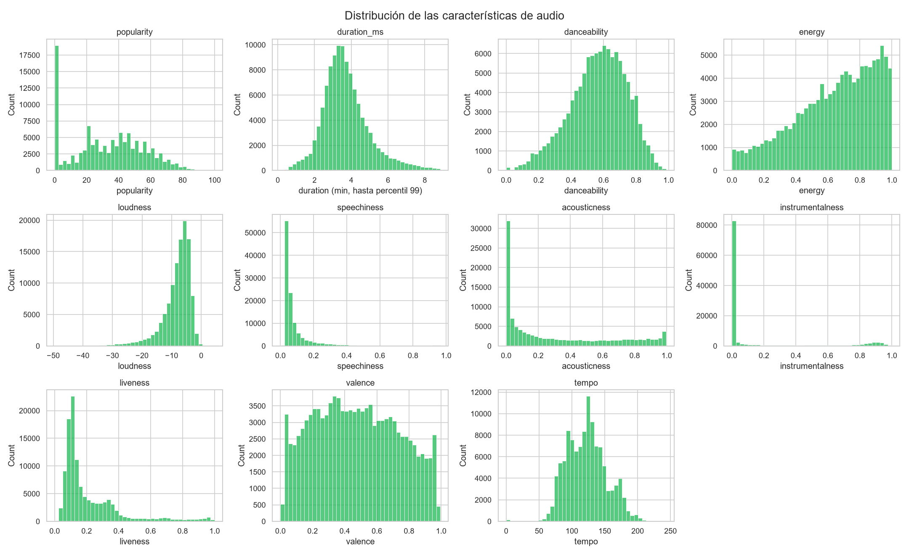
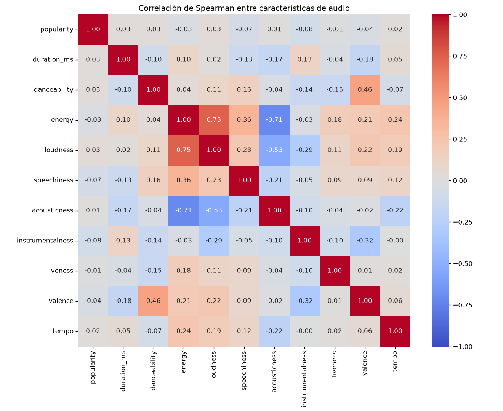
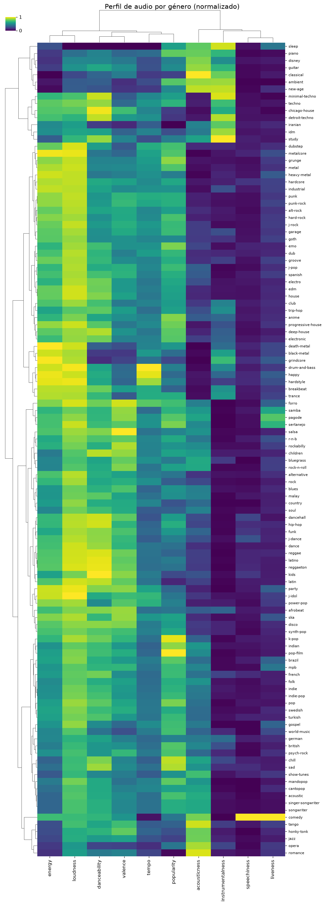
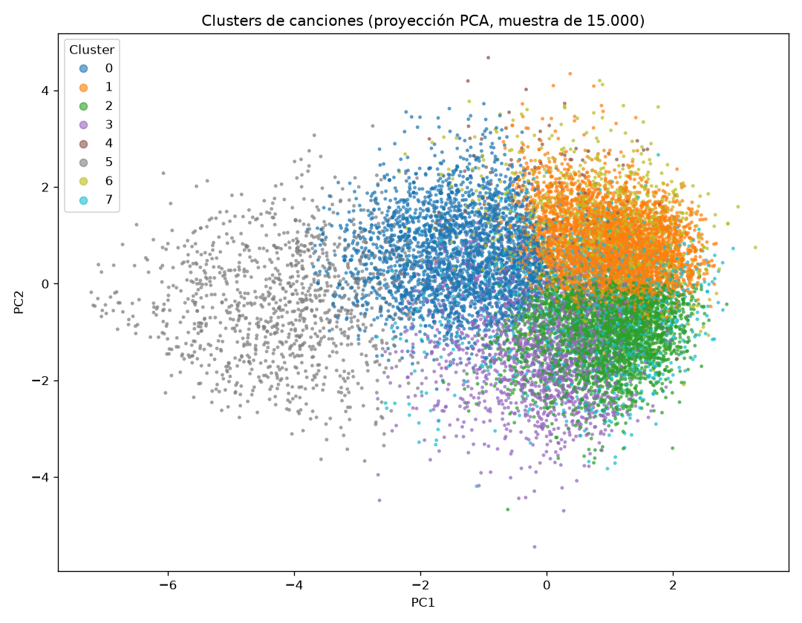

# Music Pattern Analysis

Análisis de patrones musicales sobre el [Spotify Tracks Dataset](https://www.kaggle.com/datasets/maharshipandya/-spotify-tracks-dataset) de Kaggle (114.000 canciones y 114 géneros), hecho con scripts de Python reproducibles.

El proyecto responde a tres preguntas:

1. ¿Cómo se diferencian los géneros según sus características de audio?
2. ¿Se pueden agrupar las canciones por patrones musicales, más allá del género?
3. ¿Cuánto explica el audio de la popularidad de una canción?

## Hallazgos principales

- **Calidad de datos**: de 114.000 filas se eliminan 450 duplicados exactos, 1 fila con nulos y 163 con `tempo = 0` o `time_signature = 0` (fallos de análisis de audio). Quedan 113.386 filas, que corresponden a 89.578 canciones únicas: una misma canción aparece en varios géneros.
- **Variables correlacionadas**: `energy`, `loudness` y `acousticness` forman un bloque casi redundante (`energy`-`loudness` +0,75, `energy`-`acousticness` -0,71).
- **Géneros**: `latino`, `reggaeton` y `reggae` tienen perfiles casi idénticos, y `sleep` es el género más extremo frente a la música festiva. `songwriter` y `singer-songwriter` contienen exactamente las mismas 1.000 canciones.
- **Clustering**: K-Means con k=8 da grupos interpretables (acústico suave, latino bailable, rock/metal intenso, electrónica instrumental, comedia/habla, ambient y clásica, rítmico con voz hablada y directo/brasileño). Los silhouette son bajos (0,14-0,24): los estilos forman un continuo y los clusters se solapan.
- **Popularidad**: el audio explica como mucho ~20% de la varianza (Random Forest, R² = 0,19 en validación cruzada, error medio de 12,7 puntos). La regresión lineal solo llega a 0,07, así que hay relaciones no lineales. `instrumentalness` es la variable más influyente.

## Imágenes clave









## Estructura del proyecto

```
.
├── data/
│   ├── raw/          # dataset original (no se sube al repo)
│   └── processed/    # datasets limpios y clusters (no se suben al repo)
├── src/              # scripts de análisis
├── reports/figures/  # gráficos generados
├── requirements.txt
└── README.md
```

Scripts de `src/`:

| Bloque | Scripts |
|---|---|
| EDA | `eda_overview.py`, `eda_calidad.py`, `eda_estadisticos.py`, `eda_distribuciones.py`, `eda_correlacion.py` |
| Limpieza | `limpieza_anomalias.py`, `limpieza.py` |
| Géneros | `generos_perfil.py`, `generos_heatmap.py` |
| Clustering | `preparacion.py`, `clustering_pca.py`, `clustering_k.py`, `clustering_perfil.py` |
| Popularidad | `popularidad_base.py`, `popularidad_arboles.py` |

## Cómo reproducirlo

Todos los comandos se ejecutan desde la raíz del proyecto.

**1. Entorno**

```bash
python -m venv venv
source venv/Scripts/activate   # Git Bash en Windows (en Linux/macOS: source venv/bin/activate)
pip install -r requirements.txt
```

**2. Dataset**

Crea un token en Kaggle (Settings → API → Create New Token) y guárdalo en `~/.kaggle/`. Después:

```bash
kaggle datasets download -d maharshipandya/-spotify-tracks-dataset -p data/raw --unzip
```

**3. Limpieza** (genera `data/processed/tracks_genres.csv` y `tracks_unique.csv`)

```bash
python src/limpieza.py
```

**4. Análisis, en este orden**

```bash
# EDA
python src/eda_overview.py
python src/eda_calidad.py
python src/eda_estadisticos.py
python src/eda_distribuciones.py
python src/eda_correlacion.py

# Géneros
python src/generos_perfil.py
python src/generos_heatmap.py

# Clustering
python src/clustering_pca.py
python src/clustering_k.py
python src/clustering_perfil.py

# Popularidad
python src/popularidad_base.py
python src/popularidad_arboles.py
```

`src/limpieza_anomalias.py` es opcional: solo cuenta los valores anómalos que justifican los criterios de limpieza.

## Decisiones técnicas

- **Dos datasets procesados**: `tracks_genres.csv` (una fila por canción y género) para el análisis por género, y `tracks_unique.csv` (una fila por `track_id`) para clustering y modelos, para no repetir canciones.
- **`popularity = 0` se mantiene** (14% de las filas) con la columna `sin_popularidad`, y se excluye solo en los modelos de popularidad, porque probablemente son canciones sin datos.
- **Preparación para clustering**: `log1p` en `speechiness`, `liveness`, `duration_ms` e `instrumentalness`, y `StandardScaler`. `RobustScaler` se descartó porque dejaba `instrumentalness` y `speechiness` dominando el 70% de la varianza del PCA.
- **k=8**: máximo local de silhouette (0,164) entre los k útiles. k=2 puntúa más alto, pero solo separa vocal de instrumental.
- **Correlaciones con Spearman**, por las distribuciones tan sesgadas.
- **Modelos de popularidad**: división 80/20 con semilla fija y validación cruzada de 5 particiones. Se compara contra una media constante como referencia.

| Modelo | R² (CV) | MAE |
|---|---|---|
| Media constante | 0,000 | 15,05 |
| Regresión lineal | 0,073 | 14,26 |
| Gradient Boosting | 0,175 | 13,12 |
| Random Forest | 0,194 | 12,74 |

## Limitaciones

- El dataset está balanceado por diseño (862-1.000 canciones por género), así que no refleja la proporción real de cada género en Spotify.
- Algunas etiquetas (`happy`, `chill`, `sad`, `sleep`) son más de ambiente que de género musical.
- La popularidad es una instantánea de un momento concreto, y el audio no incluye artista, fecha ni playlists, factores clave en popularidad.
- La importancia de variables describe lo que usa el modelo, no relaciones causales.
- Los clusters se solapan: son una simplificación útil, no categorías cerradas.
